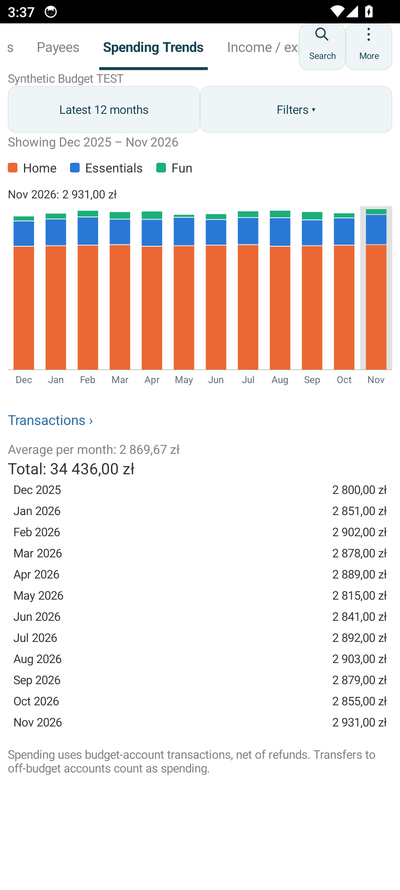

# Classic Budget Plus

Classic Budget Plus brings more of the YNAB 4 desktop workflow to Android. Add transactions quickly, manage your budget and scheduled transactions, and open reports on your phone. Morphe Manager patches the original APK and installs **YNAB Plus** directly on Android, alongside the original app, without ADB.

[Add to Morphe](https://morphe.software/add-source?github=ysosrsss/classic-budget-plus-patches) · [Download the v1.0.1 MPP](https://github.com/ysosrsss/classic-budget-plus-patches/releases/download/v1.0.1/classic-budget-plus-v1.0.1-production.mpp) · [Release notes](https://github.com/ysosrsss/classic-budget-plus-patches/releases/tag/v1.0.1)

## What it adds

Open the **Plus** button on the budget screen to get to budgeting, reports, scheduled transactions, and search. Budget loading starts without the original splash screen's fixed two-second delay.

| What you want to do | Where to start |
| --- | --- |
| Add a purchase in a few taps | Open **Add Transaction** or add either **New transaction** widget to the home screen. [Transaction entry](docs/USER_GUIDE.md#add-a-transaction) |
| Find and tidy up old entries | Tap **Plus → Search transactions**. Try **Needs a category** or **Unreconciled**, save a filter, or select eligible entries to change their category together. [Search and saved filters](docs/USER_GUIDE.md#search-and-save-filters) |
| Reuse an account or category | Tick **Remember rule** while adding a transaction, or open **Plus settings → Account suggestions → Payee rules**. [Rules, history and nearby payees](docs/USER_GUIDE.md#payee-rules-and-nearby-payees) |
| Plan the month and track goals | Open **Plus → Budgeting** to edit amounts, move money, set monthly goals, and see how much is left to fund. [Budgeting](docs/USER_GUIDE.md#budgeting) |
| Manage recurring payments | Open **Plus → Scheduled transactions** to create a schedule or preview **Upcoming** payments. [Scheduled transactions](docs/USER_GUIDE.md#scheduled-transactions) |
| See where the money went | Open **Plus → Reports**, choose a view and tap an amount to see the transactions behind it. [Reports and exports](docs/USER_GUIDE.md#reports) |
| Use Dropbox or another sync provider | Open **Plus settings → Budget and sync** for Dropbox folders, sync status and diagnostics. Koofr, WebDAV and Syncthing are available through an optional patch. [Sync and budget copies](docs/USER_GUIDE.md#sync-and-budget-copies) |
| Adjust the app for your phone | Open **Plus settings** for theme, language, form layout, alerts and report visibility. [Appearance and widgets](docs/USER_GUIDE.md#appearance-and-widgets) |

[Full user guide](docs/USER_GUIDE.md) · [Feature history](CHANGELOG.md)

## Screenshots

Captured on Android with a fictional budget. Tap an image to view it at full size.

<table>
  <tr>
    <th>Spending by category</th>
    <th>Spending trends</th>
    <th>Saved transaction filters</th>
  </tr>
  <tr>
    <td><a href="docs/screenshots/spending-by-category.png"></a></td>
    <td><a href="docs/screenshots/spending-trends.png"></a></td>
    <td><a href="docs/screenshots/saved-filters.png"></a></td>
  </tr>
</table>

[](docs/screenshots/income-vs-expense.png)

See the [Remember rule checkbox](docs/screenshots/remember-payee-rule.png) and the [Dropbox folder screen](docs/screenshots/dropbox-folder.png) in the user guide.

## Supported APK

Use your own unmodified **YNAB Classic `3.4.1_classic`**, version code `27296`, package `com.youneedabudget.ynab.app.market`. The SHA-256 below identifies the exact original file used to build and test the patches.

If you're looking for the file, search for `YNAB Classic 3.4.1_classic APK` and check the SHA-256 before patching.

```text
d49148b7c9501526c40890599d4ec4b5aad2bf57c0bd949d4649255c17f87772
```

Check the APK with `Get-FileHash -Algorithm SHA256 .\YNAB_Classic.apk` on Windows or `shasum -a 256 YNAB_Classic.apk` on macOS. The release provides the Morphe `.mpp` bundle.

## Install with Morphe

Morphe Manager is the Android app that applies the `.mpp` patches to your original YNAB Classic APK on the phone. [Get Morphe Manager from its official GitHub releases](https://github.com/MorpheApp/morphe-manager/releases).

1. Tap **Add to Morphe** above, or download the `.mpp` and import it in Morphe under **Sources → + → Local**.
2. Open **YNAB Classic** in Morphe, select your original APK file and use the recommended patches. **Install YNAB Plus** and **Budget amounts from the phone** are enabled by default.
3. Patch and tap **Install** in Morphe. Android handles installation. For an update, use the same Morphe signing key as your existing **YNAB Plus**.
4. At Dropbox setup in YNAB Plus, choose **Default location** for the usual YNAB 4 folders or **A different Dropbox folder** for a budget stored separately. Type a Dropbox path such as `/Budgets/Household`. That folder should contain `.ynabSettings.yroot`.

### Update an existing installation

If Morphe still shows an older version, download the MPP above and use **Sources → Update** on the local Classic Budget Plus source, or add it as a local source. Apply its recommended patches to the original APK and install over your existing **YNAB Plus** using the same signing key. The updated app shows **Plus settings · 1.0.1** in its header. [Source management in Morphe](https://github.com/MorpheApp/morphe-manager/blob/v2.5.0/docs/patch-sources.md#local)

### Choose a Dropbox folder

To change it later, open **Plus settings → Budget and sync → Dropbox folder**. Once all changes have synced, YNAB Plus reloads the budgets from that location and keeps your Dropbox sign-in. **Folder (Syncthing)** opens Android storage. The **Legacy Dropbox path** patch option in Morphe is usually blank. For an older installation that used a custom path in that option, keep its existing value without a leading slash when entering it in Morphe.

The **Sync: Koofr, WebDAV and Syncthing folder** and **Recover a device letter (advanced)** patches are optional and start disabled. Enable the sync patch in Morphe's Expert mode if you want the alternative providers in the app.

## Public preview

Android 14 emulator checks cover an in-place update on an isolated copy of a real budget, preservation of its configured Dropbox folder, the rule checkbox, and typing a Dropbox path in the app. Earlier builds also covered the pending-sync guard and a live switch between isolated Dropbox folders. Full phone-to-YNAB-Windows sync testing for the refreshed bundle is still pending. Try sync on a separate budget copy first.

Built with help from Codex and Claude Code.

If you run into an issue, include your phone model, Android version and the steps to reproduce it. [Report an issue on GitHub](https://github.com/ysosrsss/classic-budget-plus-patches/issues).

## Community credits

Classic Budget Plus grew out of seeing the YNAB 4 community get the Android app syncing again after Dropbox changes. In April 2022, the app needed TLS 1.2. A separate wave of problems in 2026 brought another round of community fixes.

- **u/kronicd** shared the TLS 1.2 patch in 2022, then a certificate update and a patcher in 2026. [2022 patch](https://www.reddit.com/r/ynab4/comments/u4rlma/comment/i55m5ts/) · [2026 certificate update](https://www.reddit.com/r/ynab4/comments/1qiokvb/comment/o2j6sk2/) · [2026 patcher](https://www.reddit.com/r/ynab4/comments/1qiokvb/comment/odrpdqw/)
- **u/modrzew** compared the 2022 patched APK with the original and documented how to reproduce the fix. [Comparison and instructions](https://www.reddit.com/r/ynab/comments/u4bnmi/comment/i5m38l5/)
- **u/boco_23** pointed out the Dropbox certificate change in 2026. [Original comment](https://www.reddit.com/r/ynab4/comments/1qiokvb/comment/o0ualv6/)
- **u/Magoun** shared the 2026 compatibility fix that used Android's system trust store and cipher suites. [Dropbox compatibility fix](https://www.reddit.com/r/ynab4/comments/1qiokvb/comment/odpqthm/)

Thanks also to everyone who reported the breakages and tested the fixes.

## Build

Use Java 21, Android SDK Platform 36 and Build Tools 36. Configure the SDK through `ANDROID_HOME` or a local `local.properties`. Gradle reads GitHub Packages credentials from the user's Gradle configuration or the standard GitHub Actions environment. Run `gradlew.bat buildAndroid` on Windows or `./gradlew buildAndroid` on other platforms. This repository builds the production bundle by default. The output is under `patches/build/libs`.

## License

The patch code is distributed under GPL-3.0. See [LICENSE](LICENSE), [NOTICE](NOTICE) and [third-party notices](THIRD_PARTY_NOTICES.md). YNAB and Morphe are separate projects.
