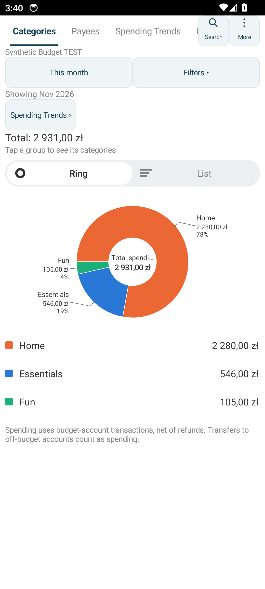
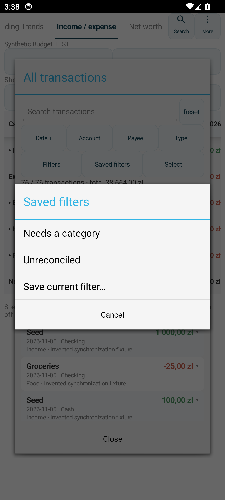
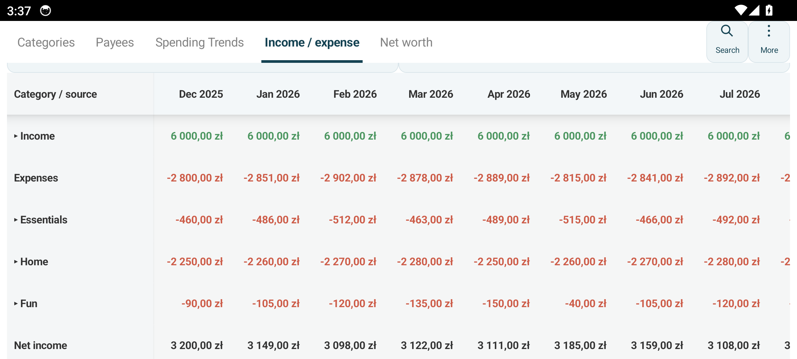

# Classic Budget Plus

Classic Budget Plus brings desktop-style reports, saved transaction filters and category budgeting to the YNAB 4 Android companion. It is an independent patch bundle for Morphe and installs as **YNAB Plus** alongside the original app.

[Add to Morphe](https://morphe.software/add-source?github=ysosrsss/classic-budget-plus-patches) · [Download the v1.0.0 MPP](https://github.com/ysosrsss/classic-budget-plus-patches/releases/download/v1.0.0/classic-budget-plus-v1.0.0-production.mpp) · [Release notes](https://github.com/ysosrsss/classic-budget-plus-patches/releases/tag/v1.0.0)

## Screenshots

Captured on Android with a fictional budget. Tap an image to view it at full size.

<table>
  <tr>
    <th>Spending by category</th>
    <th>Spending trends</th>
    <th>Saved transaction filters</th>
  </tr>
  <tr>
    <td><a href="docs/screenshots/spending-by-category.png"></a></td>
    <td><a href="docs/screenshots/spending-trends.png"></a></td>
    <td><a href="docs/screenshots/saved-filters.png"></a></td>
  </tr>
</table>

[](docs/screenshots/income-vs-expense.png)

- **Reports.** Explore category and payee spending, monthly trends, income and expenses, and net worth. Tap report amounts to see matching transactions.
- **Transactions.** Search by account, date, status and category. Save filter combinations you use often and recategorize eligible transactions in bulk.
- **Budget.** Edit a category's budgeted amount, move money between categories, add notes and see how much remains to meet a monthly goal.
- **Quick entry.** Open a new transaction from the widget and see whether fields were suggested by a saved rule, location or transaction history.

## Supported APK

Use your own unmodified **YNAB Classic `3.4.1_classic`**, version code `27296`, package `com.youneedabudget.ynab.app.market`. The SHA-256 below identifies the exact original file used to build and test the patches.

```text
d49148b7c9501526c40890599d4ec4b5aad2bf57c0bd949d4649255c17f87772
```

Check the APK with `Get-FileHash -Algorithm SHA256 .\YNAB_Classic.apk` on Windows or `shasum -a 256 YNAB_Classic.apk` on macOS. The release provides the Morphe `.mpp` bundle.

## Install with Morphe

1. Add the source using the link above, or paste this repository's URL under **Patch sources → Remote**. You can also import the `.mpp` as a local source from [v1.0.0](https://github.com/ysosrsss/classic-budget-plus-patches/releases/tag/v1.0.0).
2. Select the original APK and use the recommended patches. **Install YNAB Plus** and **Budget amounts from the phone** are enabled by default. **Sync: Koofr, WebDAV and Syncthing folder** and **Recover a device letter (advanced)** are optional and start disabled.
3. Patch and install **YNAB Plus**. For an update, use the same Morphe signing key as your existing patched app.
4. At Dropbox setup, choose **Default location** for the same folders as the original YNAB 4 app, or **A different folder** for a test copy or a budget stored separately. Enter a Dropbox path such as `/Budgets/Household`. The chosen folder should contain `.ynabSettings.yroot`.

To change the folder later, open **Plus settings → Dropbox folder**. Once all changes have synced, YNAB Plus reloads the budgets from the selected location and keeps your Dropbox sign-in.

## Public preview

The released bundle passed 14 offline Android 14 emulator checks covering an in-place update and Dropbox folder changes on an isolated budget copy. The maintainer reports that the app looks fine on their phone. Full phone-to-YNAB-Windows sync testing for this bundle is still pending. Try sync on a separate budget copy first.

If you run into an issue, include your phone model, Android version and the steps to reproduce it. [Report an issue on GitHub](https://github.com/ysosrsss/classic-budget-plus-patches/issues).

## Build

Use Java 21, Android SDK Platform 36 and Build Tools 36. Configure the SDK through `ANDROID_HOME` or a local `local.properties`. Gradle reads GitHub Packages credentials from the user's Gradle configuration or the standard GitHub Actions environment. Run `gradlew.bat buildAndroid` on Windows or `./gradlew buildAndroid` on other platforms. This repository builds the production bundle by default. The output is under `patches/build/libs`.

## License

The patch code is distributed under GPL-3.0. See [LICENSE](LICENSE), [NOTICE](NOTICE) and [third-party notices](THIRD_PARTY_NOTICES.md). YNAB and Morphe are separate projects.
